<!-- Art in assets/ is generated: node scripts/make-art.mjs. Repo tables: scripts/update-repos.mjs (daily Action). Snake: .github/workflows/snake.yml -->

<picture>
  <source media="(prefers-color-scheme: dark)" srcset="assets/banner-dark.svg">
  <source media="(prefers-color-scheme: light)" srcset="assets/banner-light.svg">
  
</picture>

<picture>
  <source media="(prefers-color-scheme: dark)" srcset="assets/terminal-dark.svg">
  <source media="(prefers-color-scheme: light)" srcset="assets/terminal-light.svg">
  
</picture>

**ECE '27 at RSET, Kochi.** I build hardware that thinks: IMU gloves, ESP32 gadgets, on-device AI, and the odd Mac app.

**Seeking a 6-month internship, Jan to Jun 2027: embedded, edge-AI silicon, VLSI.** Open to relocation.

[Portfolio](https://ryyansafar.site) · [LinkedIn](https://www.linkedin.com/in/ryyan-safar-038a82288/) · [Email](mailto:safarryyan@gmail.com)

## Featured

<picture>
  <source media="(prefers-color-scheme: dark)" srcset="assets/glove-dark.svg">
  <source media="(prefers-color-scheme: light)" srcset="assets/glove-light.svg">
  
</picture>
<picture>
  <source media="(prefers-color-scheme: dark)" srcset="assets/globe-dark.svg">
  <source media="(prefers-color-scheme: light)" srcset="assets/globe-light.svg">
  
</picture>

| Project | Outcome |
|---|---|
| [**Visa Roulette**](https://github.com/ryyansafar/visa-roulette) · [demo](https://layoverhackathon.vercel.app) | LAYOVER 2026 winner. A travel booth you play: OCR reads a passport and ticket, a JSON rules engine (not a model) gives cited visa verdicts for 113 destinations, and an ESP32 + MPU-6050 paper plane lands a 3D globe on a country. |
| [**Thaalam**](https://github.com/ryyansafar/thaalam) | Best Use of Gemma, Google Physical AI Hackathon. A 5-finger air-percussion glove. On-device Gemma on a Raspberry Pi 5 turns a song into a finger-by-finger lesson and coaches in Malayalam, English and Manglish. Led a team of 3 in 24 hours. |
| [**MacMonitor**](https://github.com/ryyansafar/MacMonitor) · [site](https://macmonitor.ryyansafar.site) | Open-source Apple Silicon menu-bar app and widget reading SMC, IOReport and Mach directly. 100+ stars, Homebrew install, Product Hunt launch, outside contributors. |
| **Camera-only road-surface depth estimation** | Research with Anoop Thomas (RSET). LiDAR is used only as training supervision on public datasets; manuscript under review. Approach only, no results yet. |

## Commit snake

<picture>
  <source media="(prefers-color-scheme: dark)" srcset="https://raw.githubusercontent.com/ryyansafar/ryyansafar/output/github-snake-dark.svg">
  <source media="(prefers-color-scheme: light)" srcset="https://raw.githubusercontent.com/ryyansafar/ryyansafar/output/github-snake.svg">
  
</picture>

What breaks if you remove me? (removal tests)

- No glove: nothing to strike, cue or judge. No Gemma: onsets with no thaalam, no finger map, no lesson, no coach.
- No rules engine: Visa Roulette is a very confident guess machine. That is why the rules decide and the model only explains.
- No Ryyan: someone else has to break things first. Unclear who volunteers.

## Latest from my repos

<!-- REPOS:START -->

**Most starred**

| Repo | Stars | About |
|---|---|---|
| [MacMonitor](https://github.com/ryyansafar/MacMonitor) | 110 | Real-time Apple Silicon system monitor — menu bar app + desktop widget for macOS |
| [help-me-survive-college](https://github.com/ryyansafar/help-me-survive-college) | 4 | a small grade calculator to see how much marks we need to pass and for each specific grade |
| [tokenbar](https://github.com/ryyansafar/tokenbar) | 4 | macOS menu bar utility that monitors token usage and spend across every AI coding tool run |

**Recently pushed**

| Repo | Last push | About |
|---|---|---|
| [MacMonitor](https://github.com/ryyansafar/MacMonitor) | 2026-10-17 | Real-time Apple Silicon system monitor — menu bar app + desktop widget for macOS |
| [visa-roulette](https://github.com/ryyansafar/visa-roulette) | 2026-10-11 | THUNA — LAYOVER 2026 hackathon project (TinkerSpace Calicut) |
| [thaalam](https://github.com/ryyansafar/thaalam) | 2026-08-31 | Thaalam: 5-finger air-percussion glove with Yousician-style real-time feedback. Pi 5 + Gem |
| [homebrew-macmonitor](https://github.com/ryyansafar/homebrew-macmonitor) | 2026-08-06 | Homebrew tap for MacMonitor — brew tap ryyansafar/macmonitor |

**Most active, last 90 days**

| Repo | Commits | About |
|---|---|---|
| [thaalam](https://github.com/ryyansafar/thaalam) | 82 | Thaalam: 5-finger air-percussion glove with Yousician-style real-time feedback. Pi 5 + Gem |
| [visa-roulette](https://github.com/ryyansafar/visa-roulette) | 32 | THUNA — LAYOVER 2026 hackathon project (TinkerSpace Calicut) |
| [MacMonitor](https://github.com/ryyansafar/MacMonitor) | 28 | Real-time Apple Silicon system monitor — menu bar app + desktop widget for macOS |

_Auto-generated daily from the GitHub API._

<!-- REPOS:END -->

## Wins

- LAYOVER 2026 overall winner (TinkerHub x The Visa Guy)
- Best Use of Gemma, Google Physical AI Hackathon Onam Edition
- First prize, KruizeX Kochi Water Metro problem-athon
- TinkerHub Maker of the Month, September 2026 ([feature](https://medium.com/tinkerhub/maker-of-the-month-sep-26-ryyan-safar-i-hope-this-works-b13827605cf5))
- Samsung Semiconductor Fellowship, via IISc Bangalore ISWDP

## What I work with

- **Embedded and hardware:** ESP32, Raspberry Pi 5 and Pico 2W, MPU-6050 IMU, IMU + GNSS Kalman fusion, custom PCB, C/C++, Python
- **VLSI:** Verilog (NPTEL), Synopsys Sentaurus TCAD (ISWDP)
- **Edge AI:** on-device Gemma on Pi 5, OCR pipelines with rules engines
- **Apps:** Swift, Objective-C, Flutter, Next.js, Flask, Firebase

Currently: Application Developer Intern at Lascade (Simline, MixRoutes). B.Tech ECE, CGPA 8.34/10.

## Support and links

- [ryyansafar.site](https://ryyansafar.site)
- [GitHub](https://github.com/ryyansafar)
- [Buy Me a Coffee](https://buymeacoffee.com/ryyansafar)
- [PayPal](https://www.paypal.com/paypalme/ryyansafar)
- [Razorpay](https://razorpay.me/@ryyansafar)
